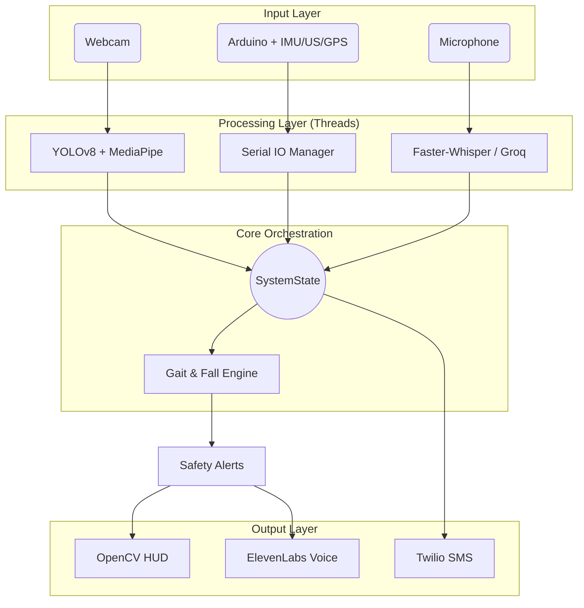

# AI Mobility Assistant
### Real-Time Gait Analysis, Fall Prevention & Assistive Navigation Platform

A real-time rehabilitation and mobility assistance platform that combines computer vision, sensor fusion, and voice interaction to provide gait analysis, fall detection, obstacle awareness, and adaptive mobility coaching on low-cost hardware.

---

# Project Highlights

*   **Real-time gait analysis** (symmetry, cadence, posture monitoring) using MediaPipe Pose.
*   **YOLOv8-based obstacle detection** with voice-guided navigation assistance.
*   **IMU + computer vision sensor fusion** for robust fall and pre-fall detection.
*   **Multi-threaded architecture** coordinating vision, audio, and hardware services.
*   **Adaptive voice coaching** using local speech recognition and context-aware LLM assistance.
*   **Automatic fall escalation** with a voice cancel window (opt-in), background SOS delivery with retries, and an offline spoken-alert fallback.
*   **Edge-first design:** pose, gait, fall-state and obstacle logic run locally. Spoken alerts (ElevenLabs) and SOS SMS (Twilio) need internet; offline, alerts appear on the HUD only.

---

# Impact

This project explores how low-cost consumer hardware can deliver mobility assistance capabilities typically associated with specialized clinical systems. By combining edge AI, sensor fusion, and voice interaction, the platform provides real-time safety feedback while preserving user privacy through local-first processing.

---

# Technology Stack

| Layer | Technology |
| :--- | :--- |
| **Vision** | OpenCV, MediaPipe Pose, YOLOv8 |
| **Embedded** | C++, Arduino, MPU9250 (IMU), Ultrasonic (HC-SR04) |
| **Speech** | Faster-Whisper (Local), Groq (Cloud LLM Enhancement) |
| **Voice/IO** | ElevenLabs (TTS), Pygame, Twilio (SMS) |
| **Runtime** | Python 3.10+ (Multi-threaded orchestration) |

---

# Technical Contributions

Key components designed and implemented:

*   **Multi-threaded Orchestration:** Coordinated 4+ asynchronous services (Vision, Serial, Audio, LLM) via a thread-safe global state.
*   **Sensor Fusion Logic:** Integrated IMU tilt-rates with CV skeletal landmarks to increase fall detection specificity.
*   **State-Machine Safety Pipeline:** Implemented robust orientation tracking (Upright -> Falling -> Fallen) to reduce false positives.
*   **Arduino Firmware:** Developed acquisition loops with complementary filtering for stable real-time orientation telemetry.
*   **Real-Time HUD:** Designed a visualization overlay for gait symmetry, MET expenditure, and obstacle navigation.
*   **Adaptive Coaching Workflow:** Context-aware routing between local safety alerts and high-level LLM guidance.

---

# System Architecture

The following diagram illustrates the multi-threaded orchestration between hardware telemetry, vision inference, and the centralized state machine.



---

# Key Engineering Decisions

### Why YOLOv8 instead of Cloud-based Detection?
*   **Decision:** Run YOLOv8s locally via `ultralytics`.
*   **Rationale:** Cloud detection introduces 200ms+ round-trip latency. Local inference typically provides sub-100ms response times on consumer hardware, critical for real-time obstacle avoidance.

### Why CSV/JSON instead of PostgreSQL?
*   **Decision:** Export to localized flat files in `exports/`.
*   **Rationale:** As a single-user edge device, a database adds unnecessary setup complexity and runtime I/O overhead for high-frequency (2Hz) research logging.

### Why a Thread-based Shared-Memory Model?
*   **Decision:** Python `threading` with `threading.RLock`.
*   **Rationale:** Low-latency access to the latest frame and sensor data is required across asynchronous services. Distributed messaging (ROS/MQTT) would introduce unnecessary serialization overhead.

---

# Performance Characteristics

*Informal observations on an i7-12th Gen / 16GB RAM development machine. Not a benchmark: no controlled protocol, sample size or variance was recorded. See [docs/EVALUATION.md](docs/EVALUATION.md) for the protocol that will replace these.*

| Metric | Observed Value | Implementation Detail |
| :--- | :--- | :--- |
| **Vision Inference** | 12–15 FPS | MediaPipe + YOLOv8s (CPU) |
| **Sensor Telemetry** | 20 Hz | Arduino Serial @ 57.6k baud |
| **Safety Latency** | Typically < 100 ms | Event-to-HUD/TTS trigger |
| **Coaching Frequency** | Every 8–12s | Adaptive rate-limiting to prevent fatigue |

---

# Lessons Learned

*   **Reliability > Accuracy:** In safety-critical systems, a stable signal is more valuable than a high-fidelity one with high latency.
*   **Temporal Context:** Fall detection needs a window of time, not just a snapshot, which is why it is a state machine. The false-positive improvement from this has not been measured yet.
*   **Sensor Synergy:** Fusing IMU and vision is the design goal; its benefit over a single modality has not been quantified yet.
*   **Graceful Degradation:** Designing fallback behavior (e.g., "Software-Only" mode) is as critical as the primary workflow.

---

# Known Limitations

*   **Lighting Sensitivity:** Pose estimation quality decreases in low-light environments.
*   **Ultrasonic Echoes:** Sensors may return false distances on angled surfaces.
*   **Clinical Validation:** Heuristics are research-oriented and not clinically validated. This is a prototype, not a medical device.
*   **No measured accuracy yet:** recall, precision, false alarms per hour and alert latency have not been evaluated. The protocol is in [docs/EVALUATION.md](docs/EVALUATION.md).
*   **Cloud dependencies:** spoken alerts need ElevenLabs and the SOS SMS needs Twilio; there is no on-device TTS or SMS fallback.

---

# Setup & Usage

1.  **Hardware:** Upload `mobility_assistant.ino` to Arduino (MPU9250 + Ultrasonics).
2.  **Software:** 
    ```bash
    pip install -r requirements.txt
    python main.py
    ```
3.  **Config:** Thresholds are configurable in `config.py`. Copy `.env.example` to `.env` and fill in API keys. SOS SMS needs the `TWILIO_*` and `EMERGENCY_PHONE` values; without them SOS reports that it could not send.

---

# Try it without hardware

```bash
python tools/demo_sim.py --list
python tools/demo_sim.py fall_unanswered      # fall -> buzzer -> automatic SOS (simulated, nothing sent)
python tools/demo_sim.py fall_cancelled       # user says "I'm okay": SOS cancelled
```

The simulator runs the real safety pipeline on synthetic IMU traces. It shows behaviour; it is not evidence of detection accuracy.

# Safety features

| Feature | Behaviour | Config |
| :--- | :--- | :--- |
| Fall state machine | UPRIGHT, TILT_WARNING, FALLING, FALLEN, RECOVERING from IMU accel and tilt | `FALL_*`, `TILT_*` |
| Automatic SOS after a fall | Cancel window, then SMS. **Off by default** until the false-alarm rate is measured | `FALL_AUTO_SOS`, `FALL_ESCALATION_SEC` |
| SOS delivery | Background thread with retries; the user is told the truth if it fails | `SOS_SEND_ATTEMPTS`, `SOS_RETRY_SEC` |
| Spoken alerts | ElevenLabs when online, on-device `pyttsx3` when offline or on failure | `ELEVENLABS_API_KEY` |
| Buzzer | Arduino buzzer on pin 7 sounds on fall / SOS (firmware not yet verified on hardware) | `BUZZ:<ms>` serial command |
| Alert latency log | Alert created to audio start, per route, in `exports/alert_latency.csv` | `LATENCY_LOG_ENABLED` |

# Testing

The unit tests run with no camera, Arduino, microphone, GPU, model download or API key:

```bash
python -m unittest discover -s tests -v
```

Fake serial, camera, audio, Twilio and LLM layers are injected and time is simulated, so state-machine timing is deterministic. They cover fall transitions and confirmation latency, tilt and pre-fall alerts, noisy / dropped / NaN IMU data, serial disconnect and recovery, SOS cooldown / retry / non-blocking dispatch, automatic escalation and cancel, offline voice and offline speech fallback, LLM circuit-breaker recovery, the orchestration pipeline, the evaluation tooling, and a scan for committed secrets. CI ([workflow](.github/workflows/tests.yml)) runs them on Python 3.10 and 3.12, plus lint and a coverage report.

These are regression tests. They show the code does what it was written to do, not that it detects real falls; for that see [docs/EVALUATION.md](docs/EVALUATION.md).

# Offline evaluation

```bash
# 1. Record a real session (set in .env): SENSOR_RECORD_PATH=session.jsonl
# 2. Replay it with different thresholds, no need to repeat the falls
python tools/replay_trace.py session.jsonl --timeline --set FALL_ACCEL_G=3.2

# 3. Score the detector on a public dataset laid out in SisFall format
python tools/dataset_eval.py /path/to/SisFall --out evaluation/sisfall_report.md
```

Dataset results describe the algorithm on that dataset, not this device.

# Dependencies

`requirements.in` is the editable list; `requirements.txt` is the compiled, pinned lockfile (`uv pip compile requirements.in --universal --only-binary :all: --python-version 3.10`). Dependabot proposes updates.

# Security

Credentials live in `.env`, never in source; see [docs/SECURITY.md](docs/SECURITY.md), including how to rotate the Twilio credential that was committed in the past.

# Models

Which weight each feature uses, plus source, licence and SHA-256, is in [docs/MODELS.md](docs/MODELS.md). Verify with `python tools/verify_models.py`.
